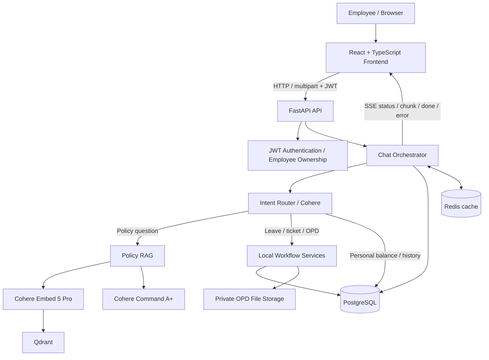
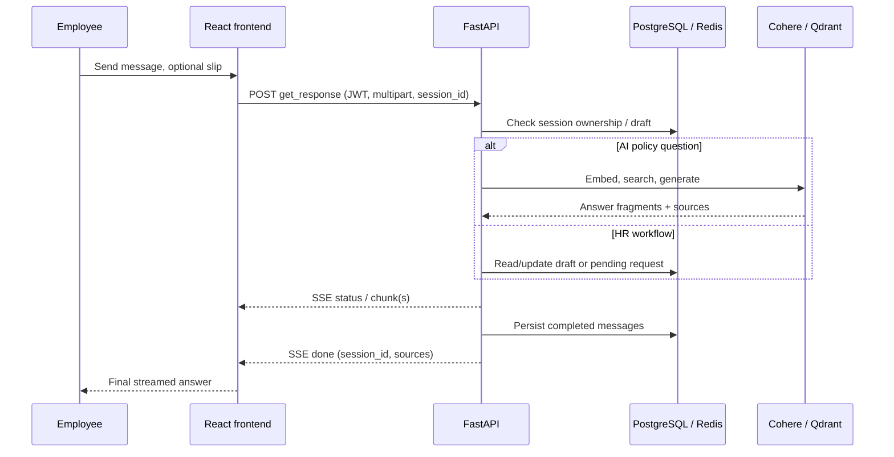
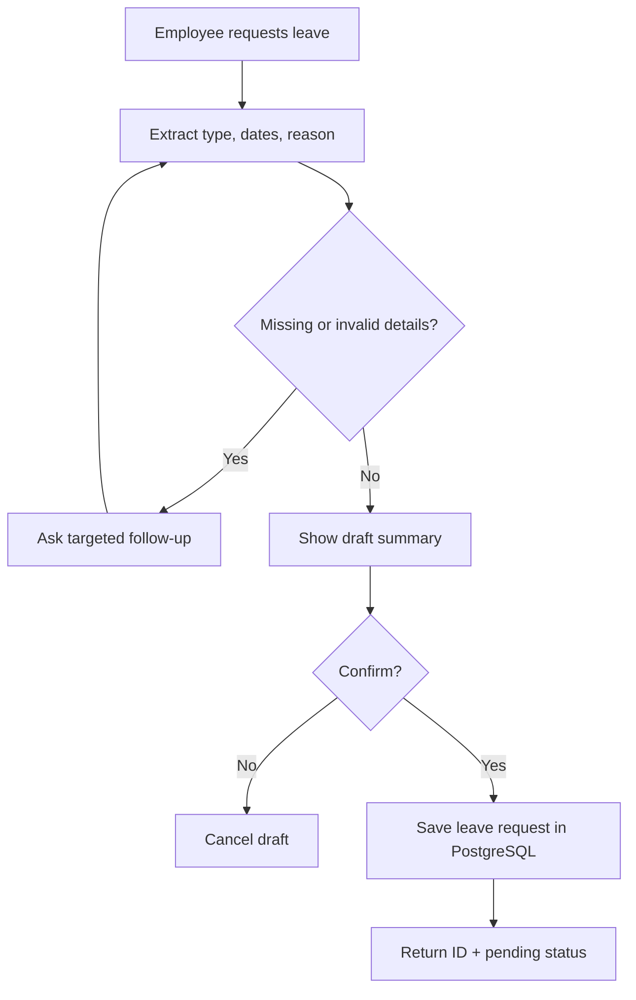

# HR Pilot Chat — Technical Architecture & Workflow Documentation

> **Project:** Standalone Cohere-powered HR assistant MVP  
> **Repository:** https://github.com/zuhairahmed26/HR-Pilot-Chat-  
> **Components:** React/TypeScript frontend, FastAPI backend, PostgreSQL, Redis, Qdrant, Cohere  
> **Document purpose:** Engineering handover, manager walkthrough, and meeting preparation  
> **Status:** Functional local MVP; **not** a production HR/payroll system

## 1. Executive overview

HR Pilot Chat offers a single conversational interface for common employee HR interactions. Instead of filling out forms for every task, an employee can ask an HR policy question, check their recorded leave balance, submit a leave request, open an IT support ticket, or initiate an OPD reimbursement request. The AI assistant interprets the request and routes it to the appropriate read-only query or local workflow.

A central distinction is that **answers and actions are different**:

- **Policy answers:** grounded in uploaded HR PDFs and supported by filename/page citations.
- **Personal records:** retrieved for the authenticated employee from the application’s local data.
- **Write operations:** collect necessary details, show a summary, require explicit confirmation, then create an appropriately labeled local record.
- **Unsupported integrations:** clearly disclosed rather than simulated as completed transactions.

The repository is deliberately separate from the original HR Pilot application. The original `app_pilot_v1` source is **not part of this GitHub repository**. This standalone implementation uses Cohere instead of the original OpenAI provider and local workflows instead of live Odoo operations.

## 2. What is implemented vs. not implemented

| Capability | MVP behavior | Boundaries |
|---|---|---|
| Employee login | Form login, JWT, employee-specific access | Local account data; production identity management not included |
| AI conversation | Cohere Command A+, live incremental SSE text, saved sessions | Requires provider connectivity for AI calls |
| Chat history | PostgreSQL persistence; Redis cache; open/rename/pin/delete | History is associated with the authenticated employee |
| Intent classification | Cohere classification plus explicit deterministic routes/fallbacks | Fallback is not equivalent to full AI classification |
| HR policy Q&A | PDF extraction, embeddings, Qdrant search, cited answers | Restricted to indexed source material; responses should not invent facts |
| Leave balance | Returns locally recorded employee leave balance | Not a live Odoo balance and not necessarily policy entitlement |
| Leave application | Multi-turn draft, review/confirmation, PostgreSQL pending request | No manager approval, balance deduction, or Odoo submission |
| Support tickets | Chat confirmation, local ticket saved as open, ticket list | No external helpdesk submission |
| OPD claims | Conversational intake; PDF or PNG/JPG receipt; missing-field follow-ups; confirmation and pending record | No automatic reimbursement or claim adjudication |
| OPD history | Read-only listing and authenticated receipt download | No approval/admin review UI |
| Payslips / salary advances / provident fund loans / external HR documents | Intent may be recognized | Live transaction handlers are not connected |

**Data provenance:** The synthetic demonstration HR policy and test employee records used during development must not be described as real company policy or real payroll/leave information.

## 3. Technology stack

| Layer | Implementation | Responsibility |
|---|---|---|
| Web client | React, TypeScript, Vite, React Markdown | Login, chat UI, streaming display, requests/status history |
| HTTP API | Python / FastAPI | Authentication, session APIs, document intake, workflows |
| Generative model | Cohere Command A+ (`command-a-plus-05-2026` in development) | Classification, policy answers, conversation responses, extraction |
| Embedding model | Cohere Embed 5 Pro (`embed-v5.0-pro` in development) | Semantic vectors for RAG queries and indexed chunks |
| Relational storage | PostgreSQL with SQLAlchemy | Employees, chats, drafts, requests, tickets, claims |
| Cache | Redis | Session/history cache support |
| Vector storage | Qdrant | Indexed policy passage embeddings and metadata |
| Documents | PyMuPDF; Cohere multimodal image input | PDF text extraction; image-slip interpretation |
| Auth | JWT bearer token | Protect APIs and enforce employee ownership |
| Files | Backend-local private upload directory | Uploaded OPD slips and related metadata |

Model names reflect the development configuration; deployment settings can override them. The exact dependency versions should be read from `backend/requirements.txt` and `frontend/package.json`.

## 4. Repository layout and primary code entry points

```text
HR-Pilot-Chat-/
├── README.md                   # Quick overview and setup
├── DOCUMENTATION.md            # This technical/meeting reference
├── .gitignore
├── backend/
│   ├── .env.example            # Placeholder config, not secrets
│   ├── requirements.txt
│   ├── scripts/
│   │   ├── init_db.py
│   │   ├── init_leave_tables.py
│   │   ├── init_ticket_tables.py
│   │   ├── init_opd_tables.py
│   │   └── seed_employee.py
│   ├── src/
│   │   ├── main.py             # FastAPI app, routers, CORS, health
│   │   ├── core/
│   │   │   ├── config.py       # Environment-backed settings
│   │   │   └── cohere_client.py
│   │   ├── database/
│   │   │   ├── database_connection.py
│   │   │   └── models.py
│   │   └── hr_management_agent/
│   │       ├── auth/           # Login, JWT, current employee
│   │       ├── chat/           # Main chat API, intents, Redis support
│   │       ├── policy_vector_store/  # PDF intake and Qdrant search
│   │       ├── leave/service.py      # Leave drafts and requests
│   │       ├── tickets/service.py    # Ticket drafts and records
│   │       └── opd/
│   │           ├── service.py        # OPD record + file storage
│   │           └── conversation.py   # OPD multi-turn intake + extraction
│   └── tests/
└── frontend/
    ├── index.html
    ├── package.json
    ├── vite.config.ts
    └── src/
        ├── main.tsx
        ├── App.tsx              # Shell, login, chat, navigation
        ├── api.ts               # Authenticated requests and SSE client
        ├── OPDClaimsPage.tsx    # OPD history/status (no submission form)
        └── styles.css
```

This layout reflects the project structure developed and tested in this MVP. If future Git commits change routes or modules, update this document alongside those commits.

## 5. High-level architecture



### Which component owns what?

- **Frontend:** presents UI and transmits employee requests; it does **not** approve claims, decide balances, or persist authoritative transactions.
- **FastAPI:** verifies tokens, enforces access controls, routes intents, validates inputs, coordinates workflows, streams output.
- **PostgreSQL:** system of record for chats and locally created HR requests.
- **Redis:** performance-oriented cache; PostgreSQL remains the persistent chat-history source.
- **Qdrant:** semantic policy search, **not** conversational memory or HR transaction storage.
- **Cohere:** AI understanding/answer generation and optional receipt interpretation; it is **not** the system of record.

## 6. End-to-end chat request lifecycle

1. Employee signs in and receives a JWT.
2. Frontend submits `POST /api/hr/chat/get_response` as `multipart/form-data` with `user_query`, optional `session_id`, `chat_history`, `stream_events=true`, and optional `attachment`.
3. Backend authenticates employee and checks ownership when reusing a session ID; a new ID is generated if omitted.
4. If an OPD/leave/ticket draft is active, the existing workflow receives the next message **before** generic intent classification. This is why a follow-up of `yes` belongs to the correct draft only when the same `session_id` is used.
5. Otherwise, the router identifies the request: conversational OPD, leave application, ticket creation, balance inquiry, conversation history, policy question, or unsupported action.
6. Policy questions retrieve evidence, then stream a model-generated answer; deterministic and workflow paths may yield a short single text chunk.
7. Completed exchanges are stored in PostgreSQL; Redis may be updated as a cache.
8. The frontend progressively renders `chunk` events and treats `done` as successful stream completion; `error` should be surfaced as an error, not success.



### SSE contract

| Event | Example purpose |
|---|---|
| `status` | `{"loading":"Generating response"}` |
| `chunk` | `{"text":"..."}`; may be many small fragments |
| `done` | `{"session_id":"...","sources":[...]}` |
| `error` | Failure such as a provider connection error; no assumption of completed chat |

**Important:** A `200 OK` response only confirms the streaming HTTP connection was established. Application errors may occur **inside** the SSE stream and must be handled by the frontend.

## 7. Intent routing and conversational state

The intent classifier distinguishes examples such as:

| User message | Intent / route |
|---|---|
| “What is our remote-work policy?” | `hr_policy_qa` → Qdrant RAG |
| “How many days of leave do I have?” | `leave_balance_inquiry` → employee record |
| “I want annual leave from ... to ...” | `leave_apply` → leave draft |
| “Please create a laptop support ticket.” | `ticket_creation` → ticket draft |
| “I want to submit an OPD claim” + receipt | Conversational OPD workflow |
| “What did I ask earlier?” | `conversation_history` → stored messages |
| “Get my salary slip” | Recognized, but external action unavailable |

Some explicit phrases can be recognized without invoking Cohere. More ambiguous messages may require Cohere classification. When the provider cannot be reached, behavior depends on whether a deterministic route is available; fallback must never be mistaken for an executed HR transaction.

**Draft state matters:** `collecting` means information is missing, `confirming` means a reviewable summary has been presented, and `submitted`/completed means a local record was created. Cancellation and draft expiry prevent stale requests from being submitted inadvertently.

## 8. Retrieval-Augmented Generation (RAG) for policy documents

### Ingestion

1. An authorized backend policy endpoint accepts PDF source documents.
2. PyMuPDF extracts available embedded text (scanned-only PDFs may need a separate OCR step).
3. Text is split into searchable passages/chunks with document metadata such as filename and page.
4. Cohere Embed 5 Pro turns passages into vectors.
5. Vectors and source metadata are stored in the configured Qdrant policy collection.

### Question answering

1. User asks a policy question.
2. Query is embedded using the search-query embedding mode.
3. Qdrant returns semantically relevant chunks, each with source metadata.
4. Cohere Command A+ receives those excerpts and instructions not to answer beyond the evidence.
5. The assistant streams a concise answer and can cite document/page.
6. The `done.sources` array contains **compact metadata** (`filename`, `page`, optional score), not whole chunks.

**Why both Qdrant and PostgreSQL?** Qdrant finds semantically related policy passages. PostgreSQL stores users, persistent conversations, and local transactions. The tools solve different problems.

**Why embeddings and generation are separate?** Embeddings convert text into vectors to enable search; Command A+ interprets and answers in natural language using retrieved evidence.

### Example from synthetic demonstration policy

Question: “What is the remote work policy?”  
Behavior: Retrieve passages from the synthetic HR policy; answer that the fictional policy allows up to two remote days weekly subject to conditions; cite the relevant file/page. This example must not be presented as actual company policy.

## 9. Conversation history / memory

- The backend identifies each chat by `session_id` and employee ID.
- Completed user/assistant exchanges are saved as `chat_data` on the database chat-history record.
- An existing session can be loaded, renamed, pinned, or deleted through chat endpoints.
- Questions such as “What was my very first question?” use **conversation-history routing**, not policy search.
- Redis can cache history, but the stored PostgreSQL conversation remains the durable record.
- An empty `sources: []` is appropriate for history recall, local HR transaction confirmations, and other responses with no policy retrieval.

**Why same session ID is mandatory:** Confirmation `yes` sent to an unrelated older session cannot confirm a newly created leave/ticket/OPD draft. This was explicitly encountered during development and is an important integration lesson.

## 10. Leave application workflow



**Supported local leave types:** annual, casual, medical. The service validates dates, reason, and ranges; some explicit ISO-date messages are parsed deterministically. Drafts have a finite lifetime (30 minutes in the development leave service). Creation is associated with the draft ID to help prevent duplicate submissions.

**Not included:** manager approval, entitlement adjudication, live balance deduction, Odoo application creation, payroll operations.

**Read-only endpoint:** `GET /api/hr/chat/leave_requests` shows the employee’s own locally saved requests.

## 11. Support ticket workflow

1. Employee asks for an IT/HR support ticket in chat.
2. Backend recognizes `ticket_creation` and prepares a local ticket draft.
3. Chat displays description and asks for explicit confirmation.
4. On `yes` within the same session, the backend saves a `SupportTicket` with status **`open`**.
5. Ticket history can be retrieved via `GET /api/hr/chat/tickets`.

**Verified development behavior:** a laptop-screen ticket was created as local ticket `#1`, subsequently retrieved with `status: open`. The ID is illustrative and depends on database state.

**Not included:** notifications to an external helpdesk, actual IT resolution, or automatic updates from a ticketing service.

## 12. Conversational OPD claims — the key differentiator

**Design principle:** OPD submission belongs in the **AI chat**, not in a standalone manual form. The OPD Claims page is **history, status, and secure attachment download only**.

### User journey

1. Employee types something natural, e.g., “Please claim my consultation expense,” and attaches a PDF, PNG, or JPG with the chat paperclip.
2. Backend stages the slip in private storage and opens an OPD draft associated with the employee and current chat session.
3. It tries to identify **amount**, **treatment date**, and **expense description** from message/document. The slip itself is required.
4. If something is missing, the assistant asks only for the missing data, using further messages in the **same session**.
5. When complete, it shows a **review summary** including attachment and the extracted values.
6. Employee replies `yes` to save the claim locally as **`pending`** or `no` to cancel.
7. The OPD Claims history page fetches records from PostgreSQL and offers a JWT-authenticated receipt download.

### PDF vs. image behavior

| Attachment | How fields are obtained | Fallback |
|---|---|---|
| Text-based PDF | PyMuPDF extracts embedded text; deterministic and/or Cohere text extraction interprets fields | Ask for unclear/missing fields |
| PNG or JPG | Existing Cohere Command A+ multimodal image input interprets receipt visually | Ask for unclear/missing fields if vision is unavailable or uncertain |
| Scanned PDF with no embedded text | Current text extraction may return little or nothing | Ask user for details; PDF OCR conversion is not a guaranteed capability |

The image is transmitted to the configured Cohere API for understanding; it is **not processed entirely offline**. Employee confirmation is important because LLM extraction can misread amounts or dates.

### Validation, ownership, and storage

- Allowed attachment types: PDF, PNG, JPEG; limit **10 MB**.
- MIME type, extension, and file signature checked; original filename is not used as the actual stored path.
- Randomized stored filenames; folder defaults to `backend/private_uploads/opd` when started from the backend working directory, configurable with `OPD_UPLOAD_DIR`.
- The claim record contains amount, treatment date, description, original/stored filename metadata, employee ID, status, timestamps.
- Date must not be in the future, amount positive with at most two decimal places, and description length validated.
- Read/list/download APIs are scoped to the authenticated employee.
- A draft expires after roughly 45 minutes in the conversational implementation.
- **No automatic approval, payout, or manager adjudication.**

### Two API paths, one preferred UI

The backend exposes a direct `POST /api/hr/chat/opd_claims` multipart endpoint for integrations/tests, but **the employee-facing MVP uses** `POST /api/hr/chat/get_response` with its optional `attachment` plus ordinary conversational follow-ups. The UI should not reintroduce a mandatory manual OPD form.

## 13. HTTP API reference

Base URL in local development: `http://127.0.0.1:8001` (accessed by the Vite proxy on port 5173). All employee endpoints below require an appropriate bearer token except login and the basic health check.

| Method | Route | Operation |
|---|---|---|
| `POST` | `/api/hr/auth/login` | Username/password form login; returns JWT |
| `GET` | `/api/hr/auth/employees/current_employee` | Current employee profile/balances |
| `POST` | `/api/hr/chat/get_response` | Multipart chat + optional receipt + SSE |
| `GET` | `/api/hr/chat/all` | Employee chat list |
| `GET` | `/api/hr/chat/{session_id}` | Read chat and messages |
| `PATCH` | `/api/hr/chat/{session_id}` | Update title or pinned status |
| `DELETE` | `/api/hr/chat/{session_id}` | Delete session |
| `POST` | `/api/hr/chat/expire_session` | Expire Redis cache for owned chat |
| `POST` | `/api/hr/chat/expire_user_sessions_from_redis` | Expire user’s Redis chat caches |
| `GET` | `/api/hr/chat/leave_requests` | List employee leave requests |
| `GET` | `/api/hr/chat/tickets` | List employee tickets |
| `POST` | `/api/hr/chat/opd_claims` | Direct multipart claim creation (integration path) |
| `GET` | `/api/hr/chat/opd_claims` | List employee OPD claims |
| `GET` | `/api/hr/chat/opd_claims/{claim_id}/attachment` | Download employee-owned slip |
| `GET` | `/health` | Basic application status |
| `GET` | `/health/dependencies` | Dependency status; admin-authenticated in development |

Policy document ingestion/administration routes are implemented in `backend/src/hr_management_agent/policy_vector_store/api.py`; consult that module or FastAPI `/docs` for exact currently installed method/path/permissions instead of relying on guessed upload paths.

### Example chat request (PowerShell)

```powershell
curl.exe -N -X POST `
  'http://127.0.0.1:8001/api/hr/chat/get_response' `
  -H "Authorization: Bearer $token" `
  -F 'user_query=What is the remote work policy?' `
  -F 'chat_history=[]' `
  -F 'stream_events=true'
```

### Example OPD message with attachment

```powershell
curl.exe -N -X POST `
  'http://127.0.0.1:8001/api/hr/chat/get_response' `
  -H "Authorization: Bearer $token" `
  -F 'user_query=I want to submit an OPD claim; please review my receipt.' `
  -F 'chat_history=[]' `
  -F 'stream_events=true' `
  -F 'attachment=@C:\path\to\synthetic-slip.png;type=image/png'
```

On the next request, pass the **returned session ID**, omit the attachment if already staged, and answer the follow-up or confirm with `yes`.

## 14. Database design and persistence

### Core data entities

| Entity/table | Purpose |
|---|---|
| Employees (existing local `employees` table) | Authenticated employee identity and stored profile |
| `HRChatHistory` | Employee-owned session ID, title, message JSON, pinned/created timestamps |
| `cohere_leave_drafts` | Temporary leave collection/confirmation state |
| `cohere_leave_requests` | Confirmed leave submissions, initially `pending` |
| `cohere_ticket_drafts` / local ticket table | Temporary ticket state and confirmed open tickets; inspect `tickets/service.py` for precise table identifiers |
| `cohere_opd_drafts` | OPD collection/confirmation state and staged file reference |
| `cohere_opd_claims` | Confirmed OPD claim and private attachment metadata |
| Qdrant policy collection | Policy vectors and source metadata (outside PostgreSQL) |

**Data integrity principles:** employee ownership filters on reads, confirmation before writes, unique draft/reference checks for key submission paths, and no direct client write to database tables. PostgreSQL and local files must be backed up together if preserving OPD records and attachments.

## 15. Frontend layout and behavior

### Screens

- **Login:** employee credentials, error/loading feedback.
- **AI Assistant:** new chat, persistent sidebar, prompts, Markdown answers, policy citations, attachment chip/paperclip, real-time streamed output, natural-language workflow confirmations.
- **Leave Requests:** read-only list/status for locally submitted leave applications.
- **Support Tickets:** read-only local ticket records and status.
- **OPD Claims:** read-only reimbursement history, pending status, and authenticated receipt downloads.

### Client details

- Frontend file `src/api.ts` centralizes `fetch`, bearer headers, login, history, request lists, SSE parsing, and OPD downloads.
- Login sends form-encoded `username`/`password` to the auth endpoint.
- Chat sends `FormData`, **not JSON**, and must let the browser set the multipart boundary.
- `AbortSignal` allows cancellation of a client stream.
- The parser processes `status`, `chunk`, `done`, and `error`; a successful `done` includes the authoritative `session_id`.
- The frontend uses the backend as the source of truth for created HR records. Do not interpret locally rendered text as a transaction receipt without backend confirmation.
- Vite development proxy routes `/api` (and `/health` as configured) to FastAPI to avoid cross-origin complexity during local development.
- A `VITE_API_BASE_URL` build-time option may be used in deployment; do not expose backend credentials or Cohere keys as Vite environment variables.

## 16. Security, privacy, and operational boundaries

### Present in MVP

- Bearer JWT authentication for employee routes.
- Employee ownership validation for sessions and sensitive OPD claims/downloads.
- Non-public local upload path with random stored filenames.
- Receipt type/size/signature validation.
- Deliberate separation between “requested/confirmed locally” and “approved/executed externally.”
- Root `.gitignore` must exclude `.env`, `.venv`, `node_modules`, `private_uploads`, actual medical slips, local test data, and original `app_pilot_v1`.

### Required before real organizational rollout

1. Get company authorization for source sharing, policies, and cloud processing of medical records.
2. Confirm data-processing, encryption-at-rest, retention/deletion, and access-control requirements for medical attachments and prompts sent to Cohere.
3. Add malware scanning, audit logging, upload quotas, file lifecycle cleanup, and request rate limiting.
4. Use HTTPS, production-grade session handling (prefer HttpOnly secure cookies where appropriate), secrets management, and well-defined CORS.
5. Introduce Alembic migrations, backups, monitoring, alerting, and automated integration tests.
6. Define manager/admin approval pathways, RBAC, and real HRMS/Odoo integrations before enabling real financial or payroll actions.

A **public GitHub repository** must not include real employee/medical data, private HR policy documents, or working credentials—even accidentally in past commits.

## 17. Local deployment / developer runbook

### Prerequisites

- Python environment compatible with the backend requirements (Python 3.12 was used during development).
- Node.js and npm.
- PostgreSQL reachable at the configured host/port.
- Redis and Qdrant running with configured endpoints.
- Cohere API key stored only in the backend `.env`.

### Typical local startup

**1. Bring up databases/services** using your existing Docker containers or configured local services. Preserve named volumes and existing database contents.

**2. Backend** (PowerShell):

```powershell
cd 'C:\Users\zuhai\Desktop\HR Pilot\backend'
.\.venv\Scripts\Activate.ps1
python -m scripts.init_db             # fresh database only; review before running
python -m scripts.init_leave_tables
python -m scripts.init_ticket_tables
python -m scripts.init_opd_tables
python -m uvicorn src.main:app --reload --port 8001
```

On an already initialized project, **do not blindly rerun seeds or destructive setup tasks**. Initializers supplied for the prototype create missing tables, but a migration framework is preferred for later schema changes.

**3. Frontend** (second terminal):

```powershell
cd 'C:\Users\zuhai\Desktop\HR Pilot\frontend'
npm install
npm run build
npm run dev
```

Open `http://127.0.0.1:5173` for UI, `http://127.0.0.1:8001/docs` for interactive API docs.

### Configuration

Copy/inspect `backend/.env.example` and `frontend/.env.example` (if needed). During local development the stack used separate ports similar to:

| Service | Development endpoint | Notes |
|---|---|---|
| FastAPI | `127.0.0.1:8001` | Local backend |
| Vite | `127.0.0.1:5173` | Local frontend |
| PostgreSQL | `127.0.0.1:55432` | Host-mapped container port |
| Redis | `127.0.0.1:56379` | Host-mapped container port |
| Qdrant | `127.0.0.1:16333` | Host-mapped container port |

These are **development settings, not fixed production requirements**. Do not copy passwords from example snippets into documentation.

## 18. Testing and verification

### Automated tests in repository

Review and run the available backend tests, for example:

```powershell
cd backend
python -m pytest tests -q
```

Individual test modules cover conversation routing, intent classification, leave validation, OPD validation, source response handling, and streaming. These tests do **not** replace end-to-end integration tests with live services.

### Manual acceptance checklist

- [ ] JWT login works; wrong credentials rejected.
- [ ] PostgreSQL/Redis/Qdrant dependency check passes with authorized account.
- [ ] Policy question streams a sourced answer and returns compact citations.
- [ ] Same-session history recall answers an earlier question without Qdrant citations.
- [ ] Leave request asks for confirmation, creates one `pending` record, and appears in history.
- [ ] Ticket request asks for confirmation, creates one `open` record, and appears in history.
- [ ] OPD text-PDF receipt produces extraction/follow-up and a reviewable summary.
- [ ] OPD PNG/JPG receipt uses image extraction where available, otherwise asks for missing fields.
- [ ] `no` cancels a draft without creating a record.
- [ ] `yes` within the correct session creates exactly one pending OPD claim.
- [ ] OPD history and authenticated receipt download work; a different employee cannot fetch the claim.
- [ ] Simulated Cohere outage gives a controlled error/fallback, not a fabricated successful submission.
- [ ] `npm run build` succeeds.
- [ ] No `.env`, credentials, OPD attachments, or company originals are tracked by Git.

**Integration status:** Chat/RAG, session recall, leave/ticket flows, and PDF OPD were tested interactively during development; image OPD was reported working in the latest user validation. This documentation is not a substitute for a clean fresh-clone acceptance run.

## 19. Troubleshooting table

| Symptom | Likely cause | Resolution |
|---|---|---|
| `connection refused` at PostgreSQL `55432` | PostgreSQL container/service stopped | Start the existing container; verify port and `.env`; avoid creating a new empty DB |
| `getaddrinfo failed` calling Cohere | DNS/provider connectivity problem | Check network/proxy/DNS; retry when service is reachable; distinguish from model failure |
| `ModuleNotFoundError: cohere` | Wrong Python interpreter or missing SDK | Activate backend `.venv`, inspect `python -m pip show cohere` |
| `/health/dependencies` returns 401 | Admin-protected endpoint hit without suitable JWT | Use an authenticated authorized token |
| Sending `yes` does not submit | Wrong/expired `session_id` or missing draft | Reuse the `done.session_id` from the same workflow; check draft status |
| Policy answer for a history question | Incorrect routing to RAG | Ensure conversation-history route has priority and uses saved chat messages |
| Receipt image asks for everything | Vision request failed/unavailable or low legibility | Verify image processing and model access; provide missing values in chat |
| PDF works but image does not | PDF text extraction vs visual image interpretation differ | Inspect `opd/conversation.py` vision path and provider connectivity |
| `200 OK` but chat fails | SSE begins successfully then emits `error` | Inspect event stream and backend log; don't treat HTTP 200 alone as completion |
| Frontend API errors | Vite proxy / backend port / token expired | Verify both servers, token, and proxy config |

## 20. Architecture decisions and trade-offs

| Decision | Why it was made | Trade-off |
|---|---|---|
| Separate frontend/backend | Independent development, clear API boundary | Two services to run |
| One conversational interface | Lower friction for HR workflows | Requires robust multi-turn state management |
| PostgreSQL as transaction source of truth | Structured durable records and ownership checks | Requires migrations/backups |
| Redis for cache, not sole persistence | Better resilience when cache unavailable | Additional infrastructure |
| Qdrant for policy chunks | Semantic search plus source metadata | Requires embedding/collection management |
| Command A+ for generation and vision | One provider for language and receipt image understanding | Network/cloud dependency and extraction uncertainty |
| Explicit confirmation for HR writes | Prevent accidental or fabricated submission | Additional message before action |
| Local uploads / local HR actions | Fast isolated MVP without touching original app | Not production approval/payout/helpdesk integration |
| Compact citations | Keeps SSE payload small and avoids exposing full policy chunks | Frontend does not receive raw source text |

## 21. Roadmap / suggested next milestones

1. **Reliability:** Cohere connectivity monitoring, bounded retries, structured errors, request tracing, automated integration tests.
2. **Data lifecycle:** Alembic migrations, backups, retention policies, delete/revoke flows for stored medical attachments.
3. **Security:** dedicated secrets store, production session strategy, stronger role permissions, audit trail, scanning/quotas, encryption.
4. **HR operations:** manager review/approval, notifications, live Odoo/HRMS connector, balances and request reconciliation.
5. **Document intelligence:** robust OCR pipeline for scanned PDFs, evaluation dataset for field extraction and policy-grounded answer quality.
6. **Deployment:** CI/CD, containers/deployment manifests, environment separation, health monitoring, disaster recovery.

---

